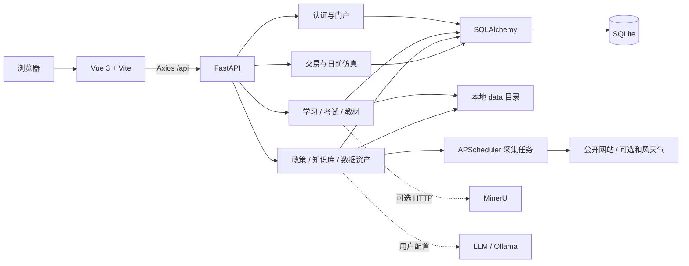

# Power Trade Lab · 电力交易演练台

> 一个可在本机部署的电力市场学习、考试与日前交易仿真平台。

[English](README.en.md) · [快速开始](#快速开始) · [配置说明](#配置说明) · [开发与验证](#开发与验证) · [已知限制](#已知限制)

Power Trade Lab 面向电力市场学习者、备考人员、从业者和二次开发者，把课程、刷题、考试、政策与知识资料、数据资产以及教学仿真放在同一个 Web 应用中。它适合个人学习、培训演示和业务原型研究，不是持牌交易系统，不连接真实交易通道，也不能作为真实交易决策依据。

## 核心能力

- **学习与诊断**：知识点树、入门诊断、8 节内置引导课程、今日任务和学习进度。
- **刷题与考试**：筛选组卷、答题判分、模拟考试、错题去重和间隔复习。
- **教材工坊**：上传 PDF、DOC、DOCX，维护章节、笔记、章节测验和阅读进度；文本型 PDF 可本地解析，复杂文档可选接入 MinerU。
- **政策与知识库**：政策筛选、用户级已读状态、知识文档、公共数据查询，以及关键词、向量和 BM25 混合检索。
- **数据资产管理**：通过文件、手工、cURL、API、RSS、Excel/CSV 等入口导入数据，记录来源、质量、审核状态和增量采集账本。
- **日前交易教学仿真**：当前提供售电公司日前购电、发电企业日前售电两类 24 时段单人场景，覆盖简报、申报、封盘、出清、结算和复盘。
- **可选 AI 助手**：用户自行配置模型服务和 API Key；Key 使用部署级主密钥加密保存在本部署数据库中。未配置模型时只返回知识召回结果。

需要注意：只有新的单人日前仿真保存规则版本、引擎版本、随机种子和完整快照。旧交易终端仍包含非固定随机数据，因此不能把“全系统仿真”描述为完全可复现。仿真复盘目前会给出知识薄弱点和下一步建议，但尚未自动写回学习计划。

## 服务与模块

| 模块 | 职责 | 直接依赖 |
|---|---|---|
| `frontend/` | Vue 单页应用，提供登录、学习、考试、知识库和交易界面 | 后端 `/api` |
| `backend/app/` | FastAPI 路由、认证、业务逻辑、健康检查和应用生命周期 | SQLAlchemy、SQLite、本地文件目录 |
| `backend/app/db/` | ORM 模型、建表和少量 SQLite 幂等补列 | SQLite |
| `backend/crawlers/` | 公开政策、统计、行情和可选天气连接器 | APScheduler、外部公开站点 |
| `backend/scripts/` | 管理员创建和数据维护脚本 | 后端虚拟环境和数据库 |
| `backend/tests/` | 后端单元、契约与回归测试 | pytest、隔离数据库 |
| `data/` | 本地凭证、教材、附件和原始数据 | 运行时生成，主要内容不提交 |

项目没有 Redis、消息队列、Docker Compose 或必须单独启动的数据库服务。默认基础设施只有进程内访问的 SQLite 文件。

## 系统架构



启动后端时会依次创建本地目录、执行 `create_all`、运行少量幂等补列、补齐空表种子，然后启动进程内采集调度器。爬虫默认开启，启动约 30 秒后会尝试执行一次公开政策采集；不希望产生外部网络访问时，请在 `backend/.env` 中设置 `CRAWLER_ENABLED=false`。

## 技术架构

| 层 | 当前实现与主要版本 |
|---|---|
| 前端 | Vue 3.5、Vue Router 4.6、Element Plus 2.14、ECharts 6.1、Vite 8.1，JavaScript + Vue SFC |
| 后端 | Python 3.11/3.12、FastAPI 0.141.1、Uvicorn 0.39.0、Pydantic 2.13、SQLAlchemy 2.0.51 |
| 数据库 | SQLite；当前没有 PostgreSQL 驱动和正式迁移闭环 |
| 调度与采集 | APScheduler 3.11.3、HTTPX、Beautiful Soup、Playwright（动态页面按需） |
| 检索与 AI | jieba、rank-bm25、sentence-transformers；可选用户级 LLM/Ollama |
| 文档处理 | pdfplumber、openpyxl；可选外部 MinerU 服务 |
| 构建与测试 | npm、Vite、pytest、GitHub Actions |

前端锁文件中的 Puppeteer 25 要求 Node.js 22.12+；因此本项目统一以 **Node.js 22.12+** 作为支持基线，而不是笼统的 Node 20+。

## 项目目录

```text
power-trade-lab/
├── backend/
│   ├── app/                   FastAPI、领域模块与 ORM
│   ├── crawlers/              公开数据连接器与调度器
│   ├── scripts/               管理员和数据维护脚本
│   ├── tests/                 后端测试
│   ├── requirements.txt       运行依赖
│   ├── requirements-dev.txt   测试依赖
│   └── .env.example           后端配置模板
├── frontend/
│   ├── src/                   页面、组件、路由和 API 封装
│   ├── package.json
│   ├── package-lock.json
│   └── .env.example           前端可选配置模板
├── data/                      本地数据与凭证，主要内容被 Git 忽略
├── docs/                      架构、配置、业务与安全规范
├── script/sh/                 一键启动、停止、状态和公共脚本
├── scripts/                   仓库级检查工具
├── .github/                   CI 与协作配置
├── README.md
├── LICENSE
└── AGENTS.md
```

`backend/.venv/`、`frontend/node_modules/`、`frontend/dist/`、`logs/`、`.run/` 和 SQLite 数据库都是本地产物，不提交到仓库。

## 快速开始

### 环境要求

- macOS 或 Debian/Ubuntu Linux；Windows 建议使用 WSL2。
- Python 3.11 或 3.12。
- Node.js 22.12+，并带 npm。
- `curl`。
- 不需要 Docker；仓库当前没有 Dockerfile 或 Compose 配置。

脚本会复用已满足版本要求的工具。缺失工具时，它会在 macOS 上尝试使用 Homebrew、在 Debian/Ubuntu 上尝试使用 apt；系统不支持自动安装或安装后版本仍不满足时，会给出明确的手工安装方式。脚本不会通过未经确认的远程安装脚本安装 Node 或 Docker。

### 克隆并启动

```bash
git clone https://github.com/wenpeifeng/power-trade-lab.git
cd power-trade-lab

./script/sh/start-all.sh
```

首次启动会创建 `backend/.venv/`、按锁文件安装依赖、创建 SQLite 表并写入内置演示种子。`sentence-transformers` 及其依赖体积较大，首次安装可能耗时较长；后续只有依赖缺失或锁文件变化时才会重新安装。

检查状态：

```bash
./script/sh/status-all.sh
```

停止服务：

```bash
./script/sh/stop-all.sh
```

重复执行启动脚本时，只会停止 `.run/` 中记录且命令行属于当前项目的旧进程，再用当前代码重启。端口被其他程序占用时会直接报错，不会按端口误杀进程。日志写入 `logs/`，PID 写入 `.run/`；停止脚本不会删除数据库、日志、上传文件或其他业务数据。

## 访问入口与登录

| 入口 | 开发环境地址 | 说明 |
|---|---|---|
| Web | <http://127.0.0.1:5173> | Vite 开发服务器 |
| 后端根地址 | <http://127.0.0.1:8000> | FastAPI |
| API 文档 | <http://127.0.0.1:8000/docs> | 仅非生产环境开放 |
| 进程健康 | <http://127.0.0.1:8000/health> | 不检查数据库 |
| 数据库健康 | <http://127.0.0.1:8000/api/health> | 脚本校验 JSON 中的 `status=ok` |

项目有登录体系，但**没有默认账号、演示账号或默认密码**。第一次使用时可在登录页注册普通用户。需要管理员权限时，在服务启动且虚拟环境就绪后运行：

```bash
backend/.venv/bin/python backend/scripts/create_admin.py
```

该脚本交互式创建管理员或提升已有用户，密码不会回显。不要为了演示而在源码、README 或公共数据库中加入共享密码。

## 配置说明

后端主配置来自系统环境变量和 `backend/.env`；前端构建/代理配置来自 `frontend/.env`。两者都提供 `.env.example`，实际 `.env` 被 Git 忽略。

```bash
cp backend/.env.example backend/.env
cp frontend/.env.example frontend/.env   # 仅需覆盖前端默认值时执行
```

### 关键后端配置

| 变量 | 代码默认值 | 作用 |
|---|---|---|
| `ENVIRONMENT` | `development` | 设为 `production` 后启用生产安全校验并关闭 API 文档 |
| `DEBUG` | `true` | 调试开关；生产应设为 `false` |
| `DATABASE_URL` | `sqlite:///.../backend/power_trade.db` | SQLAlchemy 数据库 URL；当前开箱即用链路只验证 SQLite |
| `ALLOWED_HOSTS` | `[]` | 生产允许的 Host；生产禁止空值和通配符 |
| `CORS_ORIGINS` | 本地 5173/5174 地址 | 允许访问 API 的前端 Origin |
| `JWT_SECRET_KEY` | 空 | 开发环境生成本机密钥文件；生产必须使用至少 32 字符强随机值 |
| `LLM_CONFIG_MASTER_KEY` | 空 | 用户 AI Key 的 Fernet 加密主密钥；生产启用 BYOK 时必须显式配置 |
| `CRAWLER_ENABLED` | `true` | 是否注册和允许执行公开数据采集任务 |
| `CRAWLER_RATE_LIMIT_SEC` | `1.0` | 单个连接器请求之间的最小等待秒数 |
| `MINERU_ENABLED` | `false` | 是否调用外部 MinerU 文档解析服务 |
| `KB_EMBEDDING_MODEL` | `BAAI/bge-small-zh-v1.5` | 语义检索模型；首次使用需本地已有模型或允许下载 |
| `KB_RERANKER_MODEL` | 空 | 可选重排模型；留空不启用 |
| `QWEATHER_ENABLED` | `false` | 是否启用部署者自己的和风天气凭证 |

### 前端配置

| 变量 | 默认值 | 作用 |
|---|---|---|
| `VITE_API_BASE_URL` | `/api` | 浏览器访问后端使用的 API 前缀 |
| `VITE_DEV_API_TARGET` | `http://127.0.0.1:8000` | Vite 开发代理目标 |

完整字段和生产边界见 [配置与部署说明](docs/CONFIGURATION.md)。不要把真实 API Key、Cookie、密码或私钥写进任何 `.env.example`、README、日志或提交记录。

## 初始化数据

当前没有 Alembic 等正式迁移工具。后端启动时执行：

1. SQLAlchemy `create_all` 创建缺失表；
2. 运行少量只针对 SQLite 的幂等补列；
3. 仅在相应表为空时初始化知识点、市场、示例题、示例政策、考试蓝图、省份、知识文档、分类和 synthetic 公共数据。

内置种子随源码提交，并使用固定日期和值，因此干净环境首次启动得到一致的演示数据。它们是教学占位数据，不是完整、实时或经过逐条权威核验的官方数据集；synthetic 行也明确标记为 `synthetic`。重复启动不会清空已有表，也不会覆盖已有业务数据。

数据库默认位于 `backend/power_trade.db` 且被 Git 忽略。对重要本地数据应单独做文件级备份；不要把数据库提交到公开仓库。

## 项目难点与解决方案

### 可回放的日前仿真

随机教学场景如果只保存结果，无法解释或复现。当前单人日前流程同时保存规则版本、引擎版本、随机种子、输入、申报、出清、结算和复盘快照，使同一输入能够重放。该能力目前只覆盖两种 24 时段日前场景，旧交易终端不在这一保证范围内。

### 数据来源和降级行为

结构化公共数据记录来源等级、披露范围、原始内容哈希、解析器版本、质量和审核状态；没有可用归档行情时，交易页面会明确回退到 synthetic 数据，而不是伪装成实时行情。采集连接器仍需要部署者核对目标站点条款、授权范围和再分发许可。

### 多用户凭证隔离

登录会话使用 HttpOnly Cookie；用户自行填写的 AI Key 使用部署级 Fernet 主密钥加密入库，前端只显示脱敏提示。开发环境可生成仅本机可读的密钥文件，生产环境必须自行提供并安全托管密钥。

### 可选重型能力解耦

MinerU 作为外部服务接入，未配置时文本型 PDF 仍可使用 pdfplumber；AI 未配置时只返回知识召回片段，不伪造模型回答。Playwright 浏览器和 MinerU 模型都不在基础启动阶段自动下载。

## 项目核心亮点

- 不配置第三方账号也能运行注册、学习、刷题、考试和基础日前仿真。
- 学习、考试、教材和交易数据按当前用户隔离。
- 单人日前仿真保留完整业务快照，结果可解释、可回放。
- 数据模型包含来源、质量和审核字段，明确区分公开观测、授权、重构和合成数据。
- 一键脚本使用锁文件、PID 身份和健康接口管理进程，重复执行不会删除业务数据。
- 可选 AI、天气、MinerU 和动态页面采集不会成为基础服务的强依赖。

## 开发与验证

```bash
# 开源文件、忽略规则和高置信秘密模式检查
python3 scripts/open_source_check.py

# Python 语法检查
backend/.venv/bin/python -m compileall backend/app backend/crawlers

# 安装测试依赖并执行全部 pytest/unittest 风格后端用例
backend/.venv/bin/python -m pip install -r backend/requirements-dev.txt
(cd backend && .venv/bin/python -m pytest -q)

# 前端依赖与生产构建
(cd frontend && npm ci && npm run build)

# 脚本语法检查
bash -n script/sh/common.sh script/sh/start-all.sh script/sh/stop-all.sh script/sh/status-all.sh
```

后端测试覆盖认证与权限、凭证加密和 SSRF 边界、学习与错题、考试诊断、知识检索、数据资产、增量采集、交易报价校验和单人仿真的确定性。前端当前没有独立的 lint、单元测试或通用 E2E npm 命令，`npm run build` 是现有可复现的前端门禁。管理员评估接口依赖运行数据，不等同于自动化测试。

## 常见问题

### 8000 或 5173 端口被占用怎么办？

运行 `./script/sh/status-all.sh` 查看记录 PID、端口 PID 和异常状态。若端口属于其他程序，启动脚本会停止并报告，不会主动杀掉它；请自行停止占用程序后重试。

### 为什么第一次启动很慢？

后端包含 `sentence-transformers`，依赖体积较大；前端也需要按锁文件安装依赖。依赖安装成功后会记录锁文件哈希，后续启动会直接复用。

### 必须安装 Docker 吗？

不需要。仓库没有 Dockerfile、Compose 和容器化基础设施。状态脚本只报告本机 Docker 客户端/daemon 状态，不会安装、启动或停止 Docker，也不会碰用户的其他容器和 Volume。

### 启动失败后看哪里？

查看 `logs/backend.log` 和 `logs/frontend.log`，再执行 `./script/sh/status-all.sh`。脚本启动失败时会停止本次已启动且身份匹配的项目进程，但保留日志和数据库。

### 为什么 API 文档访问不到？

`/docs`、`/redoc` 和 `/openapi.json` 只在非生产模式开放。生产部署应使用单独维护的接口契约，而不是公开调试文档。

### 为什么检索模型不能下载？

代码默认按离线模式加载本地 embedding 模型，并在失败时降级。若要首次下载新模型，需要按 [配置文档](docs/CONFIGURATION.md) 准备模型缓存或在受控环境临时允许下载。

### 启停脚本会清空数据吗？

不会。`stop-all.sh` 只向两个经过身份校验的 PID 发信号；不会删除 SQLite、`data/`、日志、依赖或 Docker Volume。数据库重置必须由维护者另行备份并手工执行。

## 已知限制

- 当前完整仿真只覆盖日前、24 时段、售电/发电两个角色；96 点、撤单改单、机组组合、潮流约束和真实交易接入尚未形成完整链路。
- 旧交易终端包含非固定随机行情和撮合；只有新的单人日前场景承诺快照和确定性。
- 复盘知识薄弱点尚未自动写回学习计划。
- SQLite 适合单机；当前没有正式 schema migration、PostgreSQL 驱动、多实例限流或高可用方案。
- 内置政策、题目和文档是演示/占位数据，不是官方完整数据集；部分标为真题的内容缺少逐题原始来源证据。
- 外部站点、天气、AI、MinerU 和动态页面采集是否可用，取决于部署者配置、网络和第三方服务条款。

## 生产使用说明

仓库默认配置只适合本地开发和教学演示。生产部署至少应：

- 使用 `ENVIRONMENT=production`、`DEBUG=false`，配置强随机 `JWT_SECRET_KEY`、严格 `ALLOWED_HOSTS` 和 `CORS_ORIGINS`；启用用户 AI Key 时配置并备份 `LLM_CONFIG_MASTER_KEY`。
- 在 HTTPS 反向代理后运行后端，限制数据库、上传目录和凭证目录的文件权限，建立备份与恢复演练。
- 明确采集来源的访问条款、授权、频率、署名和再分发边界；默认开启的爬虫不代表所有站点已经获得使用授权。
- 在迁移到 PostgreSQL、多实例或容器前，自行补齐数据库驱动、正式迁移、共享限流、持久化、监控和发布回滚。本仓库当前不提供可直接用于生产的 Docker 部署方案。
- 不把演示数据、开发密钥或本地自动生成密钥当作生产凭证，也不创建共享默认密码。

本项目采用 [MIT License](LICENSE)。提交改动前请阅读 [CONTRIBUTING.md](CONTRIBUTING.md)、[SECURITY.md](SECURITY.md) 和 [AGENTS.md](AGENTS.md)，并同步更新受影响的代码、测试和文档。
