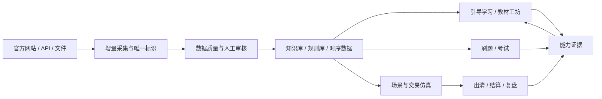

# ⚡ Power Trade Lab · 电力交易演练台

> 面向中国电力市场学习者的开源「学、练、考、仿真、复盘」一体化平台。

**[English](README.en.md)** | 简体中文

<p>
  
  
  
  
  
  
  
</p>
<a href="https://github.com/wenpeifeng/power-trade-lab/stargazers">
  
</a>

电力交易不是一张行情图，也不是把股票终端换成电力术语。本项目把**真实规则、公开数据、主动学习和可复现仿真**放进同一条能力闭环：

```text
规则与真实数据 → 知识库与课程 → 刷题与考试 → 交易仿真 → 结算复盘 → 薄弱点再学习 ↺
```

如果这个方向对你有帮助，欢迎点一个 **Star** ⭐——它会帮助更多电力市场学习者发现项目，也会决定我们优先完善哪些省份、规则和仿真场景。

---

## 📖 30 秒了解

### 这是什么

一套可以自己部署的电力市场教学与研究环境：从中长期、日前、实时到辅助服务的**规则学习**、**刷题备考**、**申报出清结算全流程仿真**，到**可解释复盘**，全部在一个本地可跑的全栈应用里完成。

### 适合谁用

| 你是…… | 你的痛点 | Power Trade Lab 给你 |
|---|---|---|
| 🎓 电力市场小白 | 中长期、日前、实时、辅助服务分不清，不知道第一笔申报怎么下 | 分层诊断 → 引导课程 → 从零建立业务认知 |
| 📝 备考人员 | 题库和知识点割裂，答错后缺来源、缺解析、缺复习 | 错题关联知识点与原文，间隔复习闭环 |
| 📈 学习型交易员 | 政策、公告、行情、天气数据分散，难以形成可追踪资产 | 数据资产中心：增量采集、去重、质量评分、来源追踪 |
| 🔧 开发者 | 缺一个能承载课程+规则+数据+仿真+复盘的开源业务底座 | FastAPI + Vue 3 全栈架构，MIT 协议自由扩展 |

### 它有什么不同

1. **数据来源诚实分级**——所有行情与仿真数据明确标记 `observed_public` / `observed_authorized` / `reconstructed` / `synthetic` 四级来源。**绝不把重构或合成数据伪装成真实实时行情**。
2. **仿真可复现**——同一场景、规则版本、输入数据、随机种子和申报集合，必然得到同一出清结果。
3. **闭环而非拼盘**——复盘发现的薄弱点会回流成课程与题目推荐，而不是学、练、考、仿各管一段。
4. **零配置可启动**——不填任何第三方 Key 也能跑通基础学习与仿真；AI、天气、文档解析全部是可选增强。
5. **BYOK 设计**——不收集任何用户 API Key；需要 AI 能力时，每位用户在前端填自己的 Key，加密入库。

> ⚠️ 本项目**不是**持牌交易系统，不提供投资建议，不能用于真实交易决策；它的目标是让学习过程**可解释、可复现、可追踪**。

## ✨ 核心特性

- 🏠 **门户与学习路径** —— 个人学习路径、能力进度、新手任务、跨系统入口
- 📚 **学习中心** —— 分层诊断、引导课程、自由刷题、错题复习、模拟考试备考
- 📄 **教材工坊** —— PDF/Word 导入、MinerU 转 Markdown、章节阅读、笔记与章节检查
- 📊 **仿真交易** —— 行情、申报、持仓、订单簿、单人全流程场景、封盘、出清、结算、复盘
- 📢 **政策公告** —— 官方日期倒排、分类、省份、已读状态、原文追踪
- 🔍 **电力知识库** —— 分类树、多维标签、关键词/BM25/语义/混合检索、知识关联
- 🗄️ **数据资产中心** —— 多源接入、增量采集、去重、质量评分、人工审核、资产时间线
- 🤖 **AI 助手（可选）** —— 当前登录用户 BYOK，基于知识库引用回答，教材内容加工
- 🌤️ **国内天气（可选）** —— 和风天气实况与逐小时预报，数据进入资产库供学习和仿真使用

## 🔄 产品能力闭环



## 🗂️ 功能全景

| 系统 | 已具备能力 | 当前定位 |
|---|---|---|
| 门户 | 个人学习路径、能力进度、新手任务、跨系统入口 | 稳定 |
| 学习中心 | 分层诊断、引导课程、自由刷题、错题复习、考试备考 | 稳定迭代 |
| 教材工坊 | PDF/Word 导入、MinerU 转 Markdown、章节阅读、笔记、章节检查 | Beta |
| 仿真交易 | 行情、申报、持仓、订单簿、单人全流程场景、封盘、出清、结算、复盘 | Beta |
| 政策公告 | 官方日期倒排、分类、省份、已读状态、原文追踪 | 稳定迭代 |
| 电力知识库 | 分类树、多维标签、关键词/BM25/语义/混合检索、知识关联 | Beta |
| 数据资产中心 | 多源接入、增量采集、去重、质量评分、人工审核、资产时间线 | 管理员功能 |
| AI 助手 | 当前登录用户 BYOK、基于知识库引用回答、教材内容加工 | 可选增强 |
| 国内天气 | 和风天气实况与逐小时预报，数据进入资产库供学习和仿真使用 | 默认关闭 |

## 📸 演示与截图

建议第一次了解项目时依次体验：

1. 门户的今日路径与能力闭环
2. 引导学习的一节完整课程
3. 教材工坊导入一本电力市场教材
4. 单人全流程交易仿真
5. 政策公告的原文追踪
6. 数据资产的增量采集、审核和时间线

项目发布前可将脱敏后的截图和录屏放入 `docs/showcase/`。推荐文件名、录屏脚本和隐私检查项见 [演示素材指南](docs/SHOWCASE.md)。README 不内置开发者本机截图，避免把用户名、教材、API Host 或业务数据误传到 GitHub。

## 🚀 快速开始

### 环境要求

- macOS / Linux（Windows 建议使用 WSL2）
- Python 3.11 或 3.12
- Node.js 20+
- npm

### 本地启动

```bash
git clone https://github.com/wenpeifeng/power-trade-lab.git
cd power-trade-lab

# 首次运行自动创建虚拟环境并安装依赖
./start.sh
```

访问：

- Web：<http://127.0.0.1:5173>
- API 文档：<http://127.0.0.1:8000/docs>

停止服务：

```bash
./stop.sh
```

第一次打开系统时注册普通账号即可。基础学习、刷题和仿真不要求配置天气、AI 或 MinerU。

### 配置入口：只需填一个文件

整个项目**只有一个配置入口**：`backend/.env`（由 `backend/.env.example` 复制而来，已被 `.gitignore` 忽略）。

```bash
cp backend/.env.example backend/.env
# 按需编辑 backend/.env；开发环境保持留空也能跑
```

- **本地学习/开发**：不填任何 Key 也能启动，登录密钥和加密密钥会自动生成到本地 `data/credentials/`。
- **关掉爬虫**：在 `.env` 里设 `CRAWLER_ENABLED=false` 即可，调度器不注册任何定时任务。
- 爬取目标 URL 为各适配器内的出厂默认值，开箱即用，无需在 `.env` 填写；`backend/crawlers/sources.yaml` 是源目录说明文档（未接入运行时），仅供查阅。
- 完整字段表见 [配置与部署说明](docs/CONFIGURATION.md)。

### 教材与 PDF 解析依赖什么

| 能力 | 依赖 | 是否需额外安装 | 说明 |
|---|---|---|---|
| 文本型 PDF 解析 | `pdfplumber`（Python 库） | 否，随 `requirements.txt` 装入 `backend/.venv` | 默认走这条链路，零额外安装 |
| 复杂 PDF / 扫描件 / Word | [MinerU](https://github.com/opendatalab/MinerU) | 是，需单独部署为 HTTP 服务 | MinerU 是基于模型的文档解析服务（版面/OCR/表格），本项目只通过 HTTP 调用，不内置模型 |

- MinerU 默认关闭（`MINERU_ENABLED=false`），不开启不影响基础学习和仿真；复杂 PDF 会降级用 `pdfplumber` 全文解析。
- 如需开启：自行部署 MinerU 服务，在 `.env` 填 `MINERU_ENABLED=true` 与 `MINERU_API_URL`（如 `http://127.0.0.1:18000`）。本项目不负责安装 MinerU 模型权重。
- 爬虫渲染交易中心动态页用 Playwright + Chromium，首次需执行 `backend/.venv/bin/playwright install chromium`（仅在使用交易中心爬虫时需要）。

### 数据从哪来：跑爬虫 / 粘贴 curl 抓取

仓库不附带业务数据——数据由你自行用「数据资产中心」的工具拉取，每个人拉自己的公开/自有内容，不存在再分发问题。下载者填数据的推荐路径：

1. 建管理员：`backend/.venv/bin/python backend/scripts/create_admin.py`
2. 登录 → 进「数据资产中心」
3. 点「立即运行」爬公开源（政策/统计/行情/碳市场…），或用「cURL 快速抓取」粘贴一条 curl 命令把某篇网页立刻收进来；也支持上传文件、手动录入、Excel 批量、API 直连、RSS、飞书导入。

全部工具的端点、前置与**可粘贴示例**见 [数据资产工具使用说明](docs/数据资产工具使用说明.md)。

## 👤 管理员账号

项目**没有默认管理员用户名和密码**，也不会在所有部署之间共享一个"统一管理员"。正确模型是：

- 每个独立部署拥有自己的用户库和管理员。
- 首次部署由部署者创建一个初始 Owner 管理员。
- 个人本地部署建议只保留一个管理员。
- 团队部署可以按需增加管理员，但每人使用独立账号，不共享密码。

创建或将已有用户提升为管理员：

```bash
backend/.venv/bin/python backend/scripts/create_admin.py
```

脚本交互式读取用户名和密码，密码不会回显或写入日志。再次运行脚本可以配置其他管理员；这用于团队协作和灾备，不代表项目存在公共管理员账号。

## ⚙️ 配置：哪些必填，哪些选填

### 本地学习/开发

**没有必须填写的第三方 Key。** 不创建 `backend/.env` 也能启动，开发环境会在被 Git 忽略的本地目录生成登录和加密密钥。

### 生产部署必填

| 参数 | 作用 |
|---|---|
| `ENVIRONMENT=production` | 启用生产安全校验 |
| `JWT_SECRET_KEY` | 签发登录会话，必须使用强随机值 |
| `LLM_CONFIG_MASTER_KEY` | 加密各用户自行填写的 AI Key |
| `ALLOWED_HOSTS` | 允许访问后端的真实域名 |
| `CORS_ORIGINS` | 允许访问 API 的前端 HTTPS Origin |
| `DATABASE_URL` | 正式多用户部署建议使用 PostgreSQL，并自行安装驱动、验证迁移 |

### 可选增强

| 功能 | 开关/配置 | 不配置时 |
|---|---|---|
| 爬虫调度 | `CRAWLER_ENABLED`、`CRAWLER_RATE_LIMIT_SEC` 等 | 默认开启，仅采集公开政策/统计/行情与交易中心公开公告页 |
| 用户 AI | 每位用户在页面中填写自己的 GLM 等 API Key | AI 解读与生成能力不可用，基础功能正常 |
| MinerU 解析 | `MINERU_ENABLED`、`MINERU_API_URL` 等 | PDF 使用降级解析，复杂 PDF/Word 能力受限 |
| 和风天气 | `QWEATHER_ENABLED` 和部署者自己的和风凭证 | 默认关闭，不会调用任何人的天气账号 |
| 向量模型 | `KB_EMBEDDING_MODEL`、`KB_RERANKER_MODEL` | 使用本地默认或关键词检索降级 |
| 前端代理 | `VITE_API_BASE_URL`、`VITE_DEV_API_TARGET` | 使用本地默认地址 |

完整参数、示例和费用边界见 [配置与部署说明](docs/CONFIGURATION.md)。所有变量统一收口在 [`backend/.env.example`](backend/.env.example)（复制为 `backend/.env` 后填写），前端模板见 [`frontend/.env.example`](frontend/.env.example)。

### 和风天气：默认关闭且不共享作者账号

开源默认值是 `QWEATHER_ENABLED=false`。即使下载者没有和风账号，系统也能正常运行；只有部署者主动开启并填写自己的 API Host 与 JWT/API Key 凭证后，后台才会安排天气采集。项目状态接口也不会把专属 API Host 返回给浏览器，作者本机凭证不会随源码分发。

## 🧱 技术栈

| 层 | 技术 |
|---|---|
| 前端 | Vue 3、Vite、Element Plus、ECharts、VueUse Motion |
| 后端 | FastAPI、Pydantic、SQLAlchemy、APScheduler |
| 数据库 | SQLite（本地）/ PostgreSQL（推荐生产） |
| 文档解析 | pdfplumber + 可选 MinerU 共享服务 |
| 检索 | BM25、向量语义、混合检索与可选重排 |
| 安全 | HttpOnly Cookie、角色权限、用户级 AI Key 加密、出站 SSRF 防护 |

## 📁 目录结构

按"源码 / 数据 / 文档 / 运行时依赖 / 配置入口"五层划分。带 ⓘ 的目录为运行时自动生成或本地数据，**不随源码提交**（已在 `.gitignore` 中忽略）。

```text
power-trade-lab/
├── backend/                       后端源码
│   ├── app/                       业务域：auth / study / exam / trade / knowledge / policy
│   │   └── config.py              ⭐ 统一配置入口（读 backend/.env）
│   ├── crawlers/                  公开数据增量采集
│   │   ├── adapters/              各数据源适配器（URL 默认值在此）
│   │   └── sources.yaml           源目录说明文档（未接入运行时，仅供查阅）
│   ├── scripts/                   管理员与维护脚本（create_admin 等）
│   ├── tests/                     离线契约与回归测试
│   ├── .env.example               ⭐ 配置模板（复制为 .env 后填写）
│   ├── .env                       ⓘ 本机配置（不提交）
│   ├── requirements.txt           Python 依赖清单
│   └── .venv/                     ⓘ Python 虚拟环境（start.sh 自动创建）
├── frontend/                      前端源码（Vue 3 + Vite）
│   ├── src/
│   ├── .env.example               前端配置模板
│   └── node_modules/              ⓘ JS 依赖（npm install 自动创建）
├── data/                          本地运行数据
│   ├── credentials/               ⓘ JWT/LLM/和风私钥（权限 600，不提交）
│   ├── raw/public/                ⓘ 已采集的公开原始数据（不提交）
│   ├── questions/ policies/ ...   业务数据目录
├── docs/                          产品、架构、配置与开源说明
├── scripts/                       仓库级脚本（开源泄密检查等）
├── .github/                       PR 模板、Issue 模板、Dependabot
├── start.sh / stop.sh             本地一键启停
├── LICENSE                        MIT
└── README.md / CONTRIBUTING.md / SECURITY.md / AGENTS.md
```

### 运行时依赖都装在哪

| 依赖 | 安装位置 | 谁来装 | 何时需要 |
|---|---|---|---|
| Python 包（FastAPI、pdfplumber、playwright…） | `backend/.venv/` | `./start.sh` 首次运行 | 总是 |
| JS 包（Vue、Vite、Element Plus…） | `frontend/node_modules/` | `./start.sh` 首次运行 | 总是 |
| Playwright Chromium 浏览器 | 系统缓存（`~/Library/Caches/ms-playwright/`） | `backend/.venv/bin/playwright install chromium` | 仅交易中心动态页爬虫需要 |
| MinerU 解析服务 | 独立部署，HTTP 调用（不在本仓库） | 部署者自行安装运行 | 仅复杂 PDF/Word 解析需要 |
| 和风天气、GLM 等 API | 远程服务，无需本地安装 | 在 `.env`/页面填凭证 | 可选 |

> 仓库内**不内置任何模型权重或浏览器内核**；所有"重型依赖"要么在虚拟环境里、要么在系统缓存里、要么是远程服务，保持源码仓库轻量、可复现。

## 🛠️ 开发与验证

```bash
# 开源泄密检查（不打印秘密值）
python3 scripts/open_source_check.py

# 后端测试
cd backend
./.venv/bin/python -m unittest discover -s tests -p 'test_*.py'

# 前端构建
cd ../frontend
npm run build
```

贡献前请阅读 [CONTRIBUTING.md](CONTRIBUTING.md)。系统设计基线见 [AGENTS.md](AGENTS.md) 与 [产品路线图](docs/交易模拟平台产品基线与路线图.md)。

## 🗺️ 路线图

- [ ] 扩充省级规则包与真实公开行情数据
- [ ] 完善 96 点多段申报、约束校验与确定性出清
- [ ] 打通"复盘薄弱点 → 推荐课程/题目 → 下一次仿真"
- [ ] 增加更多中长期、现货、零售、辅助服务、绿电与绿证场景
- [ ] 建立可公开再分发的脱敏演示数据集
- [ ] 完善 Docker、PostgreSQL、迁移工具和多实例部署

## ❓ 常见问题

<details>
<summary><b>这是持牌交易系统吗？能用于真实交易决策吗？</b></summary>

不能。Power Trade Lab 是教学与研究环境，不接入任何真实交易通道，不提供投资建议。它的价值在于把学习过程做得可解释、可复现、可追踪。

</details>

<details>
<summary><b>数据采集合法合规吗？</b></summary>

爬虫只访问公开且允许使用的内容，遵守站点条款、robots.txt、频率和署名要求，不绕过登录、验证码或权限控制；省级交易中心运营平台（`pmos.*.sgcc.com.cn` 等受保护系统）不纳入采集，其数据应通过官方开放平台 API 以合规主体身份接入。所有数据携带来源等级，真实市场成员数据必须由有权用户授权导入。

</details>

<details>
<summary><b>必须配置各种 API Key 才能用吗？</b></summary>

不需要。零配置即可启动并使用基础学习、刷题和仿真。AI 助手、和风天气、MinerU 文档解析均为可选增强，且全部遵循 BYOK（每人用自己的 Key）原则——项目不收集、不内置任何开发者的 Key。

</details>

<details>
<summary><b>支持哪些省份的交易规则？</b></summary>

当前以通用规则框架 + 部分省份场景为主，省级规则包正在扩充中（见路线图）。欢迎通过 Issue 或 PR 告诉我们你最需要哪个省份，或直接贡献规则包。

</details>

<details>
<summary><b>和直接看政策原文、刷题小程序相比，用它有什么优势？</b></summary>

散落的资料解决"看过"，不解决"学会"。本项目把规则、课程、题目、仿真和复盘串成闭环：答错的题能追溯到知识点与政策原文，仿真复盘暴露的薄弱点会变成下一轮学习推荐——每个环节都有证据可查。

</details>

## 🔒 数据与版权边界

- 代码开源不等于第三方网页、附件、题库、书籍或交易数据可以重新分发。
- 用户上传教材默认只归该用户使用，不自动进入公共知识库。
- 爬虫只应访问公开且允许使用的内容，并遵守站点条款、robots.txt、频率和署名要求。
- 真实市场成员数据必须由有权用户授权导入，不绕过登录、验证码或权限控制。
- 发布演示库和数据集前，应逐项检查来源、许可、个人信息和原文链接。

以下内容永远不应提交：`backend/.env`、和风天气 Ed25519 私钥、项目 ID/凭据 ID/API Key 和专属 API Host、`data/credentials/`、数据库、教材、附件和原始抓取响应。

## 🤝 参与贡献

欢迎提交 Issue、补充省份规则、贡献题目来源或改进仿真机制：

- 🐛 [报告 Bug / 提功能建议](.github/ISSUE_TEMPLATE/)（Issue 模板）
- 📋 [贡献指南](CONTRIBUTING.md)
- 🔐 [安全报告与漏洞披露](SECURITY.md)
- 🏗️ [技术架构文档](docs/ARCHITECTURE.md) · [系统设计基线](AGENTS.md) · [产品路线图](docs/交易模拟平台产品基线与路线图.md)

## ⭐ Star History

[](https://star-history.com/#wenpeifeng/power-trade-lab&Date)

---

## 📄 许可证

本项目采用 [MIT License](LICENSE) 开源。

也欢迎在 Star 后告诉我们：**你最希望先支持哪个省份、哪一种交易品种？** 你的回答会直接影响路线图的优先级。⚡
