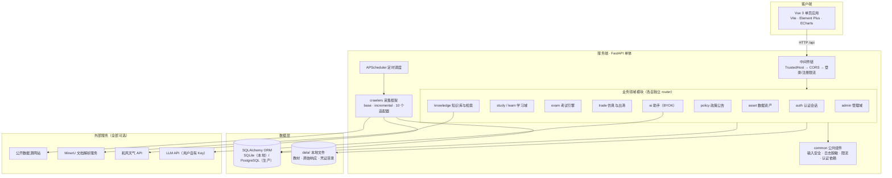
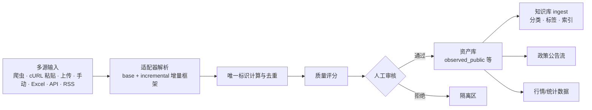
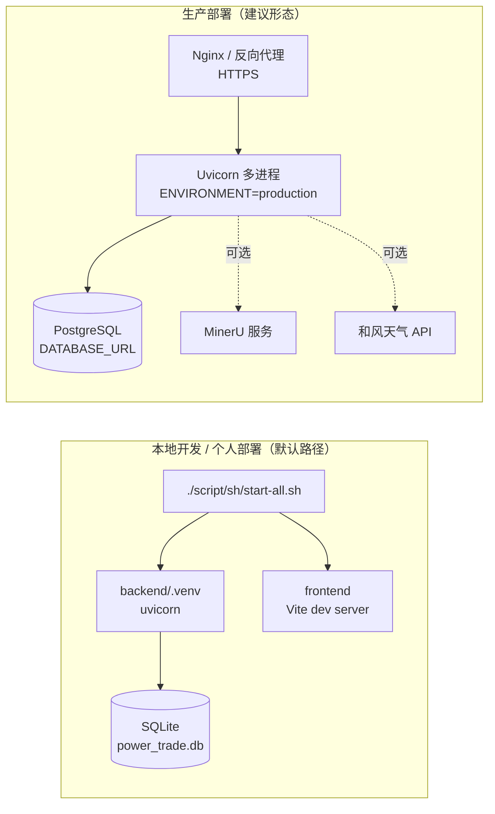

# Power Trade Lab 技术架构文档

本文档面向贡献者、技术评审与作者自审，描述系统的整体架构、模块划分、核心子系统的设计取舍，以及当前已知限制。产品定位与功能全景见 [README](../README.md)，产品协作约定见 [AGENTS.md](../AGENTS.md)。

## 1. 系统概览

Power Trade Lab 是一个前后端分离的单体应用，覆盖「数据采集 → 知识库 → 学习考试 → 交易仿真 → 结算复盘」的完整闭环。

当前代码规模：

| 维度 | 数值 |
|---|---|
| 后端 Python 源文件 | 约 94 个，约 2.07 万行（含采集适配器与脚本） |
| 前端 Vue/JS 源文件 | 约 42 个，约 2.19 万行 |
| 测试文件 | 24 个离线契约与回归测试 |
| API 路由域 | 16 个（auth、learn、study、exam、trade、knowledge、policy、asset、ai、admin 等） |
| 数据采集适配器 | 10 个公开数据源 |

## 2. 总体架构

系统采用「单体分层 + 领域模块」结构：物理上是一个 FastAPI 进程，逻辑上按业务域拆分包结构。这个选择是有意的——项目以个人和团队本地部署为主要场景，单体优先降低部署与调试成本，领域分包保留后续拆分的可能性。



要点：

- 所有外部服务（MinerU、和风天气、LLM）都是可选依赖，未配置时走降级链路（见第 6 节），基础功能不受影响。
- 密钥与凭证只存在两个位置：`backend/.env`（部署配置）与 `data/credentials/`（运行时自动生成的本地密钥），两者均被 Git 忽略。
- 后端不向前端透传任何第三方凭证或专属 API Host。

## 3. 后端架构

### 3.1 应用组装

入口为 `backend/app/main.py`（约 700 行），职责包括：

1. 挂载中间件：`TrustedHostMiddleware`（校验 Host 头）、`CORS`（按配置白名单）、登录与注册限流。
2. 统一注册 16 个领域路由，全部挂在 `/api` 前缀下。
3. 启动时初始化数据库、加载配置、按开关注册 APScheduler 定时任务（`CRAWLER_ENABLED=false` 时不注册任何任务）。

### 3.2 领域模块划分

| 模块 | 职责 | 关键文件 |
|---|---|---|
| `app/auth` | 注册、登录、HttpOnly Cookie 会话 | `router.py` |
| `app/study` | 学习内容、教材工坊、分层诊断、掌握度 | `book_service.py`、`diagnosis.py`、`guided.py`、`mastery.py` |
| `app/learn` | 刷题、错题复习、学习循环 | `router.py` |
| `app/exam` | 考试引擎与组卷 | `engine.py` |
| `app/trade` | 交易仿真、申报撮合、出清与结算 | `simulation.py`、`matching.py` |
| `app/knowledge` | 知识库：分类、标签、检索、入库 | `bm25_retriever.py`、`embedding.py`、`ingest.py`、`classifier.py` |
| `app/policy` | 政策公告：元数据抽取、日期倒排 | `article_metadata.py`、`ranking.py` |
| `app/asset` | 数据资产：多源接入、审核、质量、时间线 | 见数据流水线一节 |
| `app/ai` | AI 助手：BYOK 凭证管理、知识库引用问答、题目生成 | `credentials.py`、`assistant.py`、`question_generator.py` |
| `app/common` | 横切安全组件：输入安全、日志脱敏、限流、认证依赖 | `input_security.py`、`logging_security.py`、`rate_limit.py` |
| `app/db` | SQLAlchemy 会话与全量 ORM 模型 | `database.py`、`models.py`（约 900 行） |
| `app/eval` | 评估与回归 | `regression.py` |

### 3.3 配置管理

配置统一收口在 `app/config.py`，只读取 `backend/.env` 一个文件。设计原则：

- 零配置可启动：开发环境密钥留空时，运行时自动生成到 `data/credentials/`（权限 600）。
- 生产环境强制校验：`ENVIRONMENT=production` 时缺失 `JWT_SECRET_KEY` 等关键项直接拒绝启动。
- 爬虫目标 URL 内置于各适配器作为出厂默认值，不要求使用者在配置里填写 URL。

## 4. 前端架构

```text
frontend/src/
├── views/          按一级系统组织的页面：portal / learn / trade / knowledge / policy / admin / ai / auth
├── components/     跨页面复用组件
├── composables/    组合式函数（状态与行为复用）
├── api/            后端接口封装层
├── themes/         主题体系（学习浅色 / 仿真深色）
├── guide/          driver.js 新手引导
├── router/         路由
└── utils/          工具函数
```

前端遵循 [SYSTEM_DESIGN.md](SYSTEM_DESIGN.md) 的信息架构与视觉规范：门户与学习中心为浅色亲和风格，仿真交易为深色高密度工作台风格；两套主题在 `themes/` 内隔离，页面不跨主题混用大面积底色。

## 5. 数据架构

### 5.1 数据来源四级分级

这是整个系统最重要的数据设计。所有进入系统的行情、负荷、出清与统计数据必须携带来源等级：

| 等级 | 含义 | 前端展示要求 |
|---|---|---|
| `observed_public` | 官方公众页面、附件或开放接口的原始数据 | 展示来源名称、原始日期、披露范围 |
| `observed_authorized` | 市场成员基于合法权限授权导入的数据 | 额外展示授权主体与范围 |
| `reconstructed` | 依据公开统计、区间或报告重构的数据 | 必须标注"重构"，不得标记为真实数据 |
| `synthetic` | 教学场景生成的模拟数据 | 必须标注"合成"，不得伪装成实时行情 |

等级在数据入库时写入，随记录全链路流转到仿真、复盘与导出，前端在所有展示点强制渲染来源标识。

### 5.2 存储选型

- 本地默认 SQLite（零配置，随 `script/sh/start-all.sh` 启动即用）；当前仓库未提供 PostgreSQL 驱动和正式迁移链路。
- 通过 SQLAlchemy ORM 隔离差异，业务代码不写数据库方言。
- 当前未引入正式迁移工具（见第 9 节已知限制）。

## 6. 核心子系统设计

### 6.1 数据资产流水线



设计要点：

- 增量采集框架（`crawlers/incremental.py`）为每个来源维护增量游标与内容指纹，重复内容不重复入库。
- 采集遵守 robots.txt 与频率限制（默认请求间隔 1 秒），不采集登录态后的受保护系统（如省级交易中心运营平台），此类数据只允许通过官方开放平台以合规主体身份接入。
- 审核环节强制人工确认后数据才进入可消费状态，质量评分作为审核参考。

### 6.2 知识库检索：多级降级链路

检索设计为「关键词 → BM25 → 向量语义 → 混合 + 重排」的可降级链路：

1. 无任何模型依赖时：关键词与 BM25 检索（`bm25_retriever.py`），纯本地可用。
2. 配置 `KB_EMBEDDING_MODEL` 后：启用向量语义检索（`embedding.py`，默认模型 BAAI/bge-small-zh-v1.5）。
3. 进一步配置 `KB_RERANKER_MODEL` 后：混合召回 + 重排。

每一级都是上一级的增强而非前置依赖，保证零配置部署仍有可用的检索体验。入库侧（`ingest.py`）负责分类归类（`classifier.py`）、多维标签与知识关联。

### 6.3 仿真引擎：可复现优先

`trade` 模块的核心约束是可复现，具体机制：

- 确定性出清：同一场景版本、规则版本、输入数据、随机种子与申报集合，必须得到同一出清结果（`matching.py`）。
- 随机性隔离：随机只用于场景生成与教学扰动，且种子持久化；生产业务路径禁止调用未固定种子的 `random`。
- 全量快照：每次仿真保留场景版本、规则版本、输入快照、订单快照、引擎版本、出清结果与结算结果，复盘时可以逐环节回放。
- 品种隔离：中长期（双边协商、挂牌、集中竞价、滚动撮合）、现货（日前、实时按时段统一出清）、辅助服务、绿电绿证使用独立规则与引擎策略，不共用一个通用撮合函数。

### 6.4 AI 助手：BYOK 模式

系统不持有任何全局开发者 API Key。每位用户在前端「AI 设置」里填写自己的 Provider/Model/Key：

- 用户 Key 使用 `LLM_CONFIG_MASTER_KEY` 派生的 Fernet 密钥加密后入库，数据库不存明文。
- 问答基于知识库检索结果做引用式回答，回答附带来源，不脱离本地知识闭门生成。
- 未配置 Key 的用户不受影响，AI 功能整体是可选增强。

### 6.5 教材工坊：解析降级链路

文档解析同样是降级设计：

- 默认链路：`pdfplumber` 文本解析，随 `requirements.txt` 安装，零额外依赖。
- 增强链路：部署 MinerU 服务（基于模型的版面/OCR/表格解析）后，复杂 PDF、扫描件与 Word 走 MinerU 的 Markdown 输出。
- `MINERU_ENABLED=false` 或服务不可达时自动降级回 pdfplumber，不阻塞基础流程。

## 7. 安全架构

| 层面 | 机制 |
|---|---|
| 认证 | HttpOnly Cookie 会话（不用可被读取的 localStorage token） |
| 授权 | 角色权限（普通用户 / 管理员），路由级依赖注入校验 |
| 限流 | 登录失败锁定（窗口期 5 次）、注册频率限制 |
| 出站安全 | 数据资产中心的所有出站请求经过统一边界：响应大小上限、私网地址 SSRF 防护、可选私网白名单 |
| 密钥管理 | JWT 与 LLM 主密钥留空自动生成本地文件（600 权限）；用户 AI Key 加密入库；和风私钥只存本地凭证目录 |
| 日志安全 | `logging_security.py` 统一脱敏，Authorization、Cookie、Token 不落日志 |
| 供应链 | Dependabot 依赖更新、开源泄密检查脚本（提交前必跑） |
| 主机校验 | TrustedHost 中间件按 `ALLOWED_HOSTS` 白名单校验 |

## 8. 部署视图



本地与生产的差异全部由 `backend/.env` 驱动：生产环境强制校验 `JWT_SECRET_KEY`、`LLM_CONFIG_MASTER_KEY`、`ALLOWED_HOSTS`、`CORS_ORIGINS` 等必填项（完整清单见 [CONFIGURATION.md](CONFIGURATION.md)）。

## 9. 已知限制与演进方向

如实列出当前限制，供评审与后续迭代参考：

| 限制 | 影响 | 计划 |
|---|---|---|
| 无正式数据库迁移工具 | 表结构变更需手工同步 | 引入 Alembic |
| APScheduler 单进程调度 | 多实例部署时采集任务会重复执行 | 引入分布式锁或任务队列 |
| SQLite 写并发受限 | 多用户高频写入场景不适合生产 | 生产切 PostgreSQL（ORM 已隔离方言） |
| 无缓存层 | 热点接口在高流量下直接打数据库 | 按需引入 Redis |
| 评估脚本不等于完整测试套件 | 部分业务路径只有离线契约覆盖 | 补充单元与集成测试 |
| 仿真品种覆盖仍在扩充 | 部分品种为简化模型 | 按路线图完善 96 点多段申报与约束出清 |

## 10. 技术栈清单

| 层 | 选型 | 说明 |
|---|---|---|
| 前端框架 | Vue 3（Composition API） | 组合式函数复用状态与行为 |
| 构建 | Vite | 开发热更新与生产构建 |
| UI 组件 | Element Plus + Lucide 图标 | 中后台组件密度 |
| 可视化 | ECharts | 行情、能力雷达、数据管道 |
| 动效 | VueUse Motion | 遵循 prefers-reduced-motion |
| 引导 | driver.js | 新手任务高亮引导 |
| 后端框架 | FastAPI + Pydantic | 类型驱动的接口契约与自动文档 |
| ORM | SQLAlchemy | SQLite / PostgreSQL 双支持 |
| 调度 | APScheduler | 爬虫定时任务 |
| 采集 | httpx + Playwright（动态页） | Playwright 仅用于交易中心公开公告页 |
| 文档解析 | pdfplumber + MinerU（可选） | 降级链路设计 |
| 检索 | BM25 + bge 向量 + 可选重排 | 多级降级设计 |
| AI | 用户自有 LLM API（BYOK） | Fernet 加密存储 |
| 测试 | unittest（离线契约 + 回归） | 24 个测试文件，可离线运行 |

## 11. 相关文档

- [README](../README.md)：产品定位与快速开始
- [AGENTS.md](../AGENTS.md)：产品协作约定与业务硬性标准
- [SYSTEM_DESIGN.md](SYSTEM_DESIGN.md)：信息架构与视觉规范
- [CONFIGURATION.md](CONFIGURATION.md)：完整配置字段表
- [data-asset-architecture.md](data-asset-architecture.md)：数据资产体系设计
- [评估体系与回归测试规范.md](评估体系与回归测试规范.md)：评估与回归规范
